

  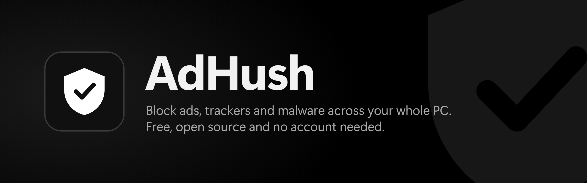

  
  
  
  

  <a href="https://github.com/D3MON999/AdHush/releases/latest"><b>Download AdHush</b></a>

A free ad blocker for your whole Windows PC, in every browser and every app, with no account and nothing left behind if you uninstall.

  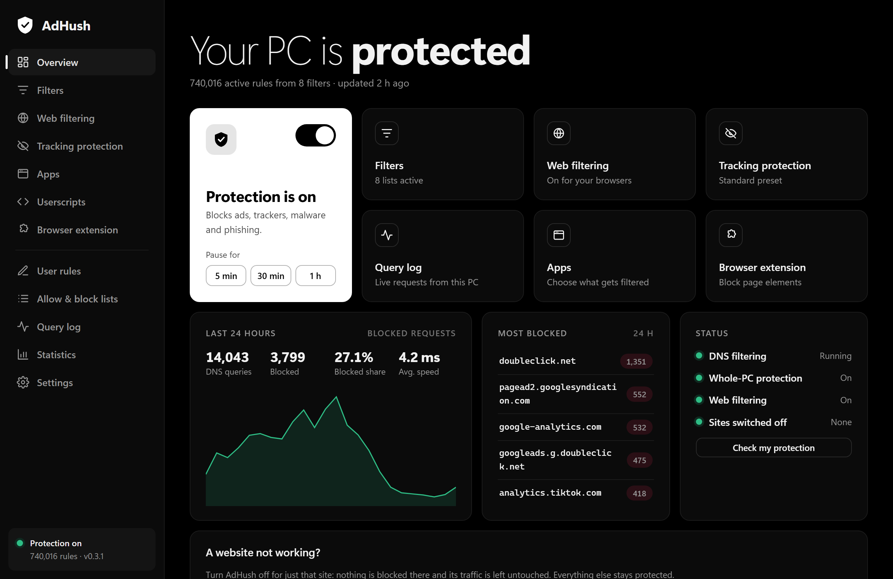

## Why AdHush

- **Your whole PC.** A browser extension protects one browser. AdHush filters at the system level, so every app is covered.
- **You can check it works.** One click runs real tests and explains the results in plain English.
- **Browsers can't skip it.** "Secure DNS" can quietly bypass ad blocking, so AdHush stops that in Chrome, Edge, Brave and Firefox.
- **Quiet while you play.** Notifications and updates wait until your full-screen game is over.
- **Nothing extra.** There are no accounts, ads or telemetry, and it's free and open source.

## What it does

<table>
  <tr>
    <td width="50%"><b>Check my protection</b> Tests the real path from your PC to the filter, then tells you what's working and what to fix.</td>
    <td width="50%"><b>Web filtering</b> Optional filtering inside pages for YouTube and in-page ads. It starts with just your browsers.</td>
  </tr>
  <tr>
    <td>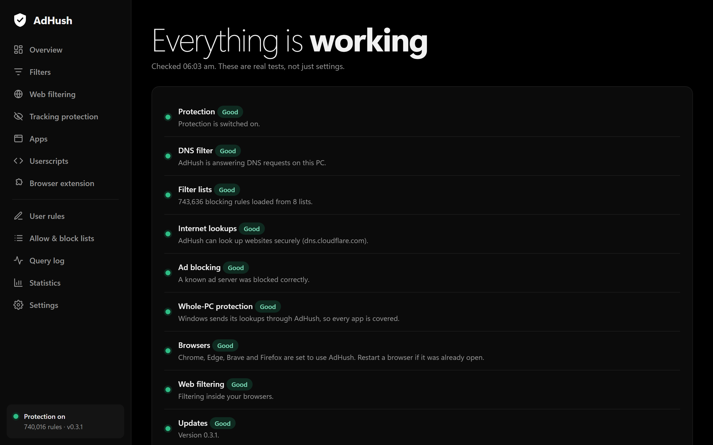</td>
    <td>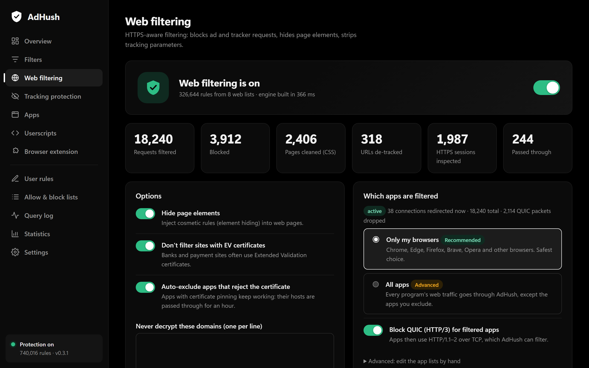</td>
  </tr>
  <tr>
    <td><b>Statistics</b> See what was blocked and which companies track you the most. It all stays on your PC.</td>
    <td><b>Query log</b> Watch every request live, and block or unblock anything in one click.</td>
  </tr>
  <tr>
    <td>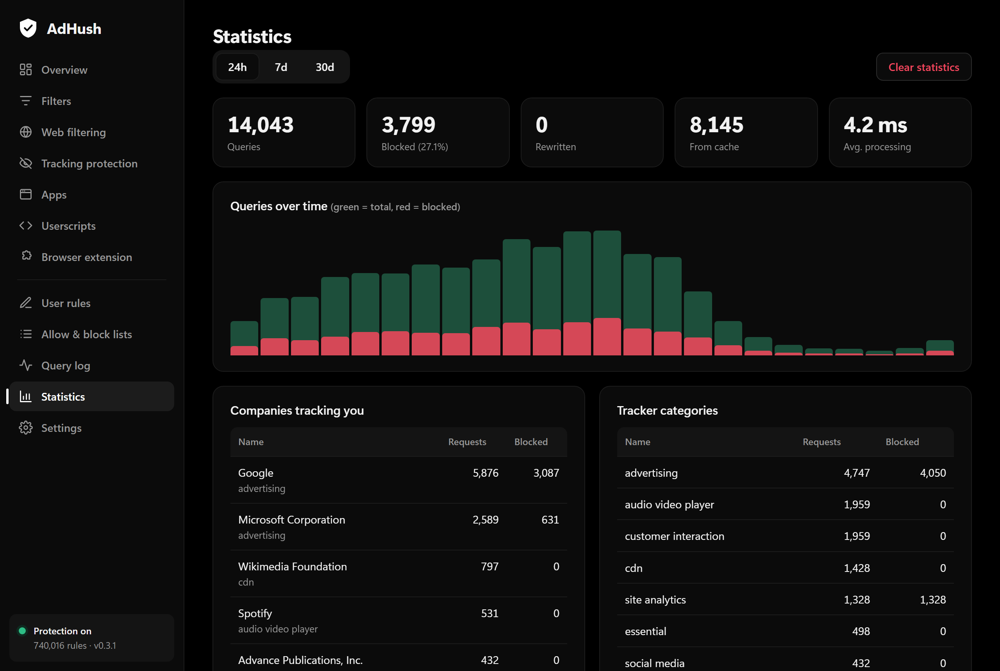</td>
    <td>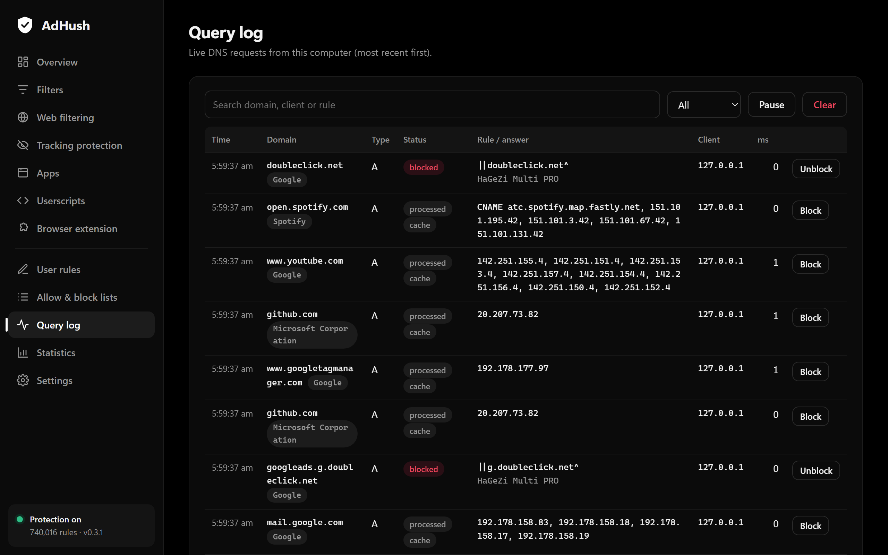</td>
  </tr>
  <tr>
    <td><b>Tracking protection</b> Pick Standard, High or Extreme, or go switch by switch. Tracking parameters are stripped from links too.</td>
    <td><b>Apps</b> Choose which programs are filtered, with a count of what was blocked in each.</td>
  </tr>
  <tr>
    <td>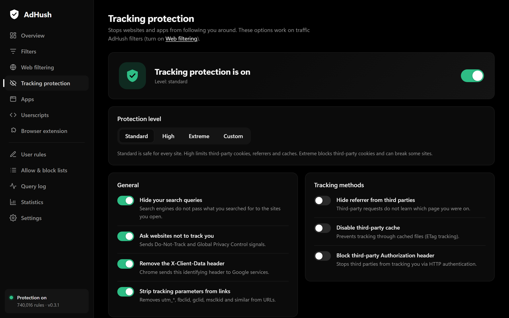</td>
    <td>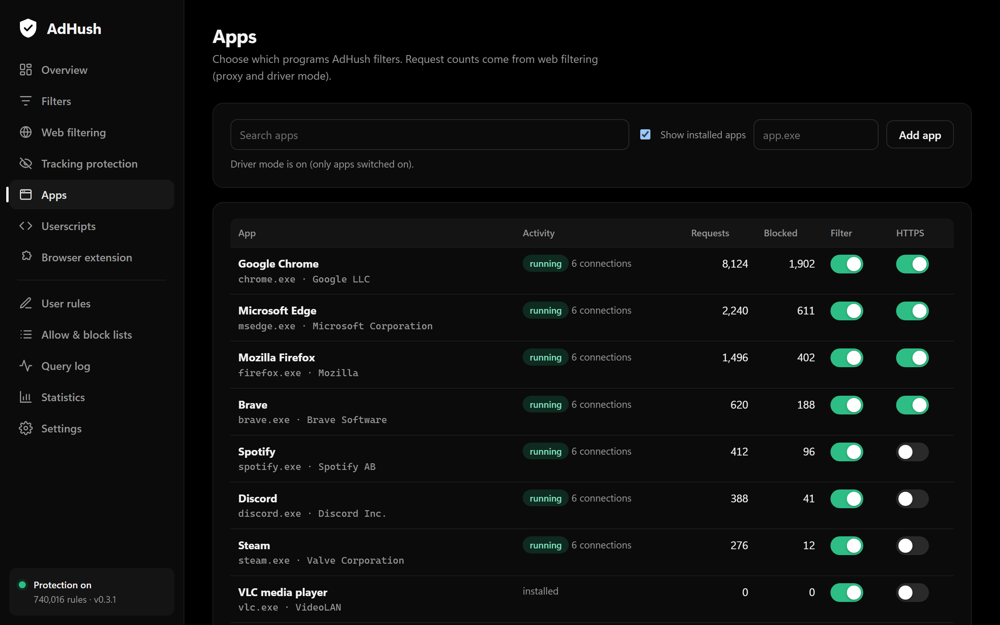</td>
  </tr>
</table>

There's more in the app: custom filter lists, your own rules, allow and block lists, encrypted DNS, userscripts and a browser extension for Chromium browsers. Safe search and adult-site blocking are there too, off until you want them.

## Safe by design

An ad blocker sits between you and the internet, so it has to fail safely.

- **Safety net.** If AdHush stops answering, your normal internet settings come back within a minute.
- **Restore normal internet.** A Start menu shortcut puts everything back, even if the app won't open.
- **Off for one site.** If a site breaks, turn AdHush off for just that site.
- **Signed updates.** Only updates signed by the developer are installed.
- **Your certificate, your choice.** Web filtering is optional. Its certificate is created on your PC and removed when you uninstall.
- **Clean uninstall.** Your DNS, browser settings and certificates go back the way they were.

**About anti-cheat:** Gaming mode reads no game memory and injects nothing into games, and web filtering only touches your browsers by default. No tool can promise what an anti-cheat will do, though, so if you play ranked, keep web filtering on *Only my browsers*.

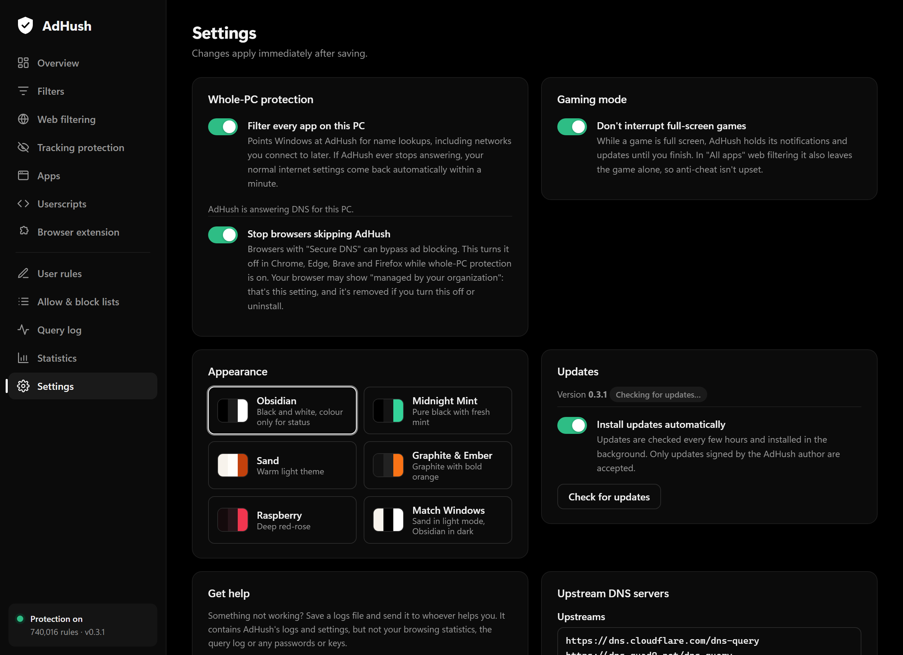

## Make it yours

Choose from five themes, or match your Windows light or dark mode.

<table>
  <tr>
    <td width="50%"><b>Midnight Mint</b> 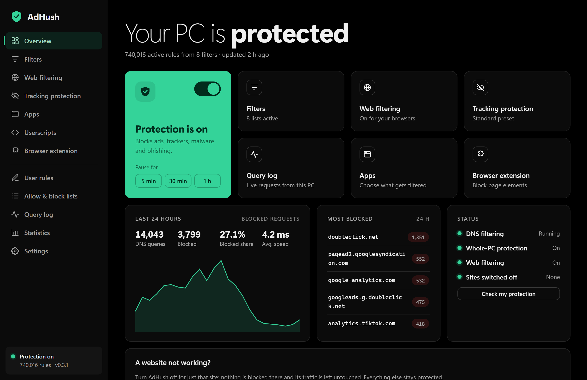</td>
    <td width="50%"><b>Sand</b> 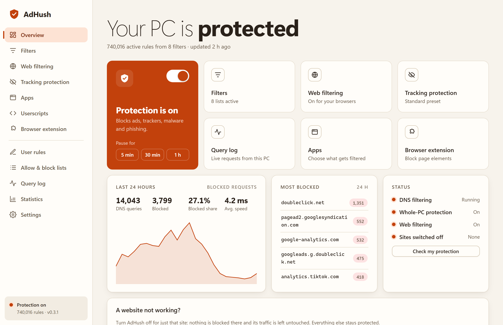</td>
  </tr>
  <tr>
    <td><b>Graphite &amp; Ember</b> 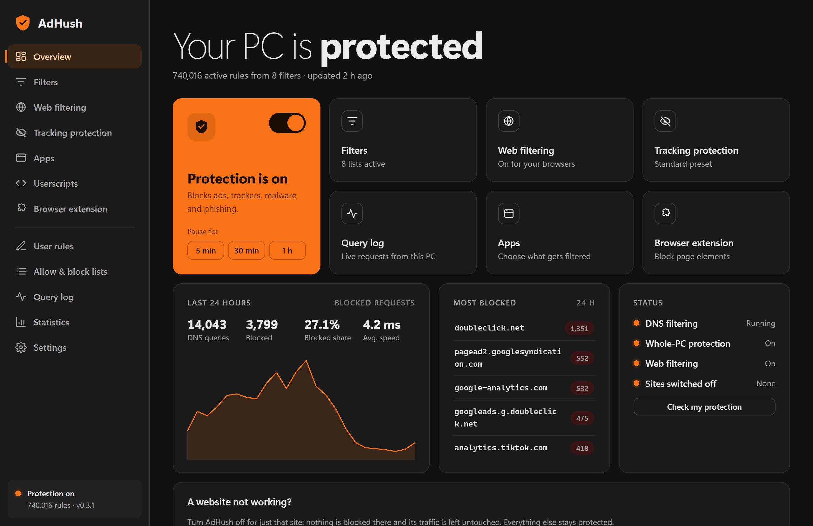</td>
    <td><b>Raspberry</b> 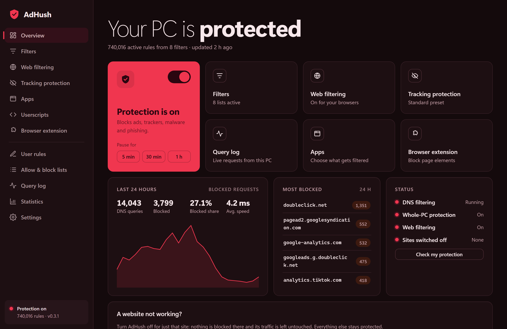</td>
  </tr>
</table>

Obsidian, the black theme shown at the top, is the default.

## Install

1. Download `AdHushSetup` from the [latest release](https://github.com/D3MON999/AdHush/releases/latest).
2. Run it. Windows will show an unknown publisher warning because the app has no paid certificate, so choose **More info**, then **Run anyway**.
3. Open AdHush. A short setup walks you through your theme and protection.

You'll need 64-bit Windows 10 or 11 and the Microsoft Edge WebView2 Runtime, which most PCs already have. AdHush updates itself from then on.

Your browser may say it's "managed by your organization" while whole-PC protection is on. That's the Secure DNS setting, and it goes away if you turn the feature off or uninstall.

## For developers

How AdHush is built, and how to build it yourself, is in [docs/DEVELOPMENT.md](docs/DEVELOPMENT.md).

## License

AdHush is free software: you can redistribute it and/or modify it under the terms of the GNU General Public License, version 3 or (at your option) any later version. See [LICENSE](LICENSE).

It bundles or downloads third-party components under their own licences; see [THIRD-PARTY-NOTICES.md](THIRD-PARTY-NOTICES.md). Filter lists and the tracker database are maintained by their respective authors and fetched from their public sources.

AdHush is an independent project and is not affiliated with or endorsed by any other ad-blocking product or company.

Screenshots use sample data.
